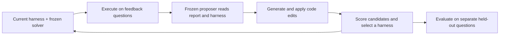

# Harness Learning Guide

**An unofficial reading companion to _Harness Learning Enables Generalizable Test-Time Adaptation_.**

A source-linked guide for researchers, engineers, curious readers, and AI agents. It explains the paper's method, evaluation protocols, reported results, and open questions. This repository contains reading material and documentation checks. **No research experiments were run, and no implementation or results were reproduced here.**

> **Credit belongs to the paper's authors:** Alvin Zhang, Xuecheng Liu, Zixuan Wang, Fahim Tajwar, Daman Arora, Ruslan Salakhutdinov, Daniel Khashabi, Yuda Song, and Andrea Zanette.
>
> arXiv:2609.35738v1 · submitted 28 September 2026 · 36 pages · [canonical paper record](https://arxiv.org/abs/2609.35738) · [version studied](https://arxiv.org/abs/2609.35738v1) · [PDF](https://arxiv.org/pdf/2609.35738v1) · [HTML](https://arxiv.org/html/2609.35738v1)
>
> [Official project](https://harness-learning.az04bz.chatgpt.site/) · [official code repository](https://github.com/AlvinZH04/Harness-Learning). The authors' code README says **“Code coming soon!”** as checked on 12 October 2026. This companion is maintained by [0xHayd3n](https://github.com/0xHayd3n), with AI assistance, and is not affiliated with or endorsed by the authors.

## The idea in one minute

A language-model agent's behavior depends on both its model and the program around it: the **harness**. The harness decides when to call the model, what context to provide, how to use tools, and how intermediate information reaches the answer.

The paper trains a **proposer** to revise a fixed **solver's** executable harness using execution feedback. Training changes the proposer's weights. At test time, both models' weights stay fixed; adaptation changes the harness code. The learned object is therefore a reusable revision procedure, rather than one universal workflow. [Paper §§1, 4, pp. 1–5](https://arxiv.org/pdf/2609.35738v1#page=1)

The diagram below is an original simplified explanation of the test-time loop, based on paper Figure 1 and §4.2. Selection and feedback differ between the two experimental settings.



## Start reading

| Your goal | Start here |
| --- | --- |
| Understand the motivation and terminology | [Concepts and context](docs/01-concepts-and-context.md) |
| Follow the equations, training, and selection rules | [Method and protocols](docs/02-method-and-protocols.md) |
| Audit the evidence and quantitative findings | [Results](docs/03-results.md) |
| Understand failure modes and what remains open | [Analysis and limitations](docs/04-analysis-and-limitations.md) |
| Find a section, figure, table, or appendix | [Paper map](docs/05-paper-map.md) |
| Discuss the paper or plan a future replication | [Questions and replication checklist](docs/06-discussion-and-replication.md) |
| Read with an AI agent | [AGENTS.md](AGENTS.md), [LLMS.txt](LLMS.txt), [paper metadata](metadata/paper.json), [claim index](metadata/claims.json) |

**A short route:** this README → concepts → results → limitations.

**A technical route:** §4 and Figures 1–2 → method notes → results and their protocols → Appendices B–F.

**A source-first route:** open the versioned PDF beside the [paper map](docs/05-paper-map.md). All page numbers in this companion are one-based PDF pages.

## What the paper reports

These are author-reported measurements and conclusions, not measurements from this repository.

| Finding | Scope and essential qualification | Evidence |
| --- | --- | --- |
| Reasoning Gym average revision score improves from about **0.32** for Base to **0.62** after SFT + single-step RL | Average over eight attempted proposals on **21 selected unseen families**, using format-varied questions. Five harder unseen families are excluded from this headline subset; across all 26 unseen families the corresponding means are **0.282 → 0.528**. | [§5.2, p. 6](https://arxiv.org/pdf/2609.35738v1#page=6), [B.1, p. 16](https://arxiv.org/pdf/2609.35738v1#page=16), [Table 9, p. 21](https://arxiv.org/pdf/2609.35738v1#page=21) |
| The trained 4B proposer exceeds the 35B teacher on average: **0.62 vs 0.56** | Same 21-family single-step protocol. The teacher has the higher oracle best-of-eight score, **0.85 vs 0.83**. This is not a general model-capability comparison. | [§5.2, p. 6](https://arxiv.org/pdf/2609.35738v1#page=6), [Table 9, p. 21](https://arxiv.org/pdf/2609.35738v1#page=21) |
| HotpotQA-trained revision policies improve workflows on unseen MuSiQue and 2WikiMultihopQA | For MuSiQue, single-step RL averages about **0.15** exact match over independent proposals and about **0.27** after ten rounds. Sequential and independent comparisons match proposals per run, while total compute and feedback remain unmatched. | [§5.3, p. 7](https://arxiv.org/pdf/2609.35738v1#page=7), [Figure 5, p. 8](https://arxiv.org/pdf/2609.35738v1#page=8), [Table 23, p. 34](https://arxiv.org/pdf/2609.35738v1#page=34) |
| Training on individual revisions can support repeated test-time improvement | Single-step training and single-round inference are different concepts. Both trained configurations can revise repeatedly. | [§§4.3, 5.4, pp. 5–7](https://arxiv.org/pdf/2609.35738v1#page=5) |
| Training on revision sequences has mixed benefits | Multistep RL uses immediate revision rewards and does not consistently beat Single-step RL; it does not directly assign credit over an entire adaptation chain. | [§5.4, p. 7](https://arxiv.org/pdf/2609.35738v1#page=7), [§6.3, p. 9](https://arxiv.org/pdf/2609.35738v1#page=9) |

See [results](docs/03-results.md) for population sizes, failed-proposal treatment, metrics, uncertainty, and the distinction between development selection and held-out oracle comparisons.

## Two experimental settings, two protocols

| | Reasoning Gym | Multi-hop QA |
| --- | --- | --- |
| Proposer / solver | Qwen3.5-4B / Qwen3.5-4B | Qwen3-4B / Qwen3-8B |
| Starting harness | One solver call | Existing two-hop retrieval workflow |
| Training | Teacher SFT, then RL on a smaller family set | RL on HotpotQA without teacher SFT |
| Transfer test | Entire task families excluded from both training stages | MuSiQue and 2WikiMultihopQA excluded from training |
| Sequential inference | Five rounds, one proposal each | Ten rounds, eight proposals each; four runs |
| Retention | Replace only if development score strictly improves | Advance to best runnable candidate, even if below parent; keep parent if all fail |

Source: [Table 1, p. 6](https://arxiv.org/pdf/2609.35738v1#page=6), [B.1, pp. 15–16](https://arxiv.org/pdf/2609.35738v1#page=15), [D.3–D.4, pp. 33–34](https://arxiv.org/pdf/2609.35738v1#page=33). Held-out evaluation questions remain separate from adaptation feedback and candidate selection. “Test-time adaptation” here includes graded development feedback; the study does not establish label-free adaptation in arbitrary deployment.

## How to use this repository with an agent

Ask the agent to read [AGENTS.md](AGENTS.md) first, then the relevant note and its primary source. For example:

```text
Explain the paper's inner and outer loops using docs/02-method-and-protocols.md.
For each factual claim, include the paper section and PDF page.
Separate author-reported evidence from your interpretation.
Do not treat this repository as an implementation or a replication.
```

The structured metadata pins the paper version, author list, license, official links, and claim scope. The [glossary](docs/01-concepts-and-context.md#glossary) aligns terms used in the notes with the paper.

## Repository contents

```text
README.md                       Overview, reading routes, headline findings
AGENTS.md                       Grounding and editing rules for agents
LLMS.txt                        Compact navigation for language-model readers
docs/01-concepts-and-context.md  Motivation, terminology, related-work framing
docs/02-method-and-protocols.md  Notation, objectives, training, evaluation
docs/03-results.md               Reported measurements and qualifications
docs/04-analysis-and-limitations.md
docs/05-paper-map.md             Page, section, figure, and table navigation
docs/06-discussion-and-replication.md
metadata/paper.json              Versioned bibliographic and provenance data
metadata/claims.json             Source-linked claims with scope and caveats
metadata/sources.json            Verified primary-source register
CITATION.cff                     GitHub citation metadata; paper preferred
references/paper.bib             BibTeX for the paper
ATTRIBUTION.md                   Credits and license boundaries
LICENSE                         License for original companion material
CONTRIBUTING.md                  Evidence and correction guidelines
scripts/validate_repository.py   Offline document/metadata/link checks
```

## Cite and credit

When discussing the research, cite **Zhang et al. (2026)** and the paper, rather than this companion. [BibTeX](references/paper.bib) and [CITATION.cff](CITATION.cff) include all nine authors. The arXiv-issued DOI is [10.48550/arXiv.2609.35738](https://doi.org/10.48550/arXiv.2609.35738); the arXiv record marked registration pending when checked. The versioned arXiv link is the pinned source.

The original companion documentation is shared under **CC BY 4.0**, with scope explained in [ATTRIBUTION.md](ATTRIBUTION.md) and [LICENSE](LICENSE). The paper independently carries CC BY 4.0, while its official code repository carries MIT. This repository does not redistribute the paper PDF, its full text, its original figures, or the authors' code.

## Quality and maintenance

Run the documentation checks with Python 3:

```bash
python scripts/validate_repository.py
```

These checks validate repository structure, metadata, local links, and anchors. They do not validate research results. Factual statements were checked against the v1 paper, with relevant figure pixels inspected. Official metadata and project/code status were checked on **12 October 2026**. [Source provenance](metadata/paper.json) records that the public v1 PDF was used after attachment materialization encountered a host limitation; byte-for-byte equivalence to the uploaded attachment was not established.

Corrections with precise primary-source evidence are welcome. See [CONTRIBUTING.md](CONTRIBUTING.md).

The preparation checks and their scope are recorded in [VERIFICATION.md](VERIFICATION.md).
